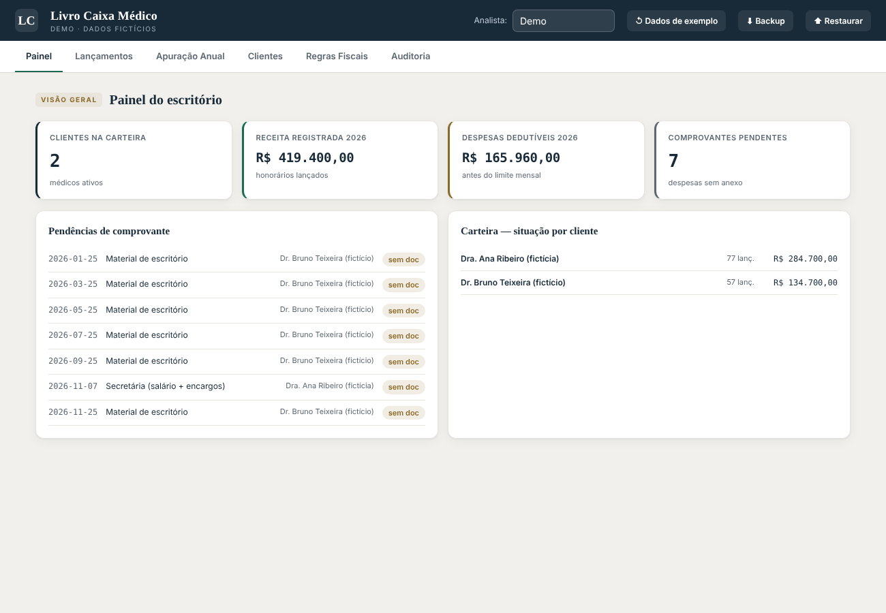
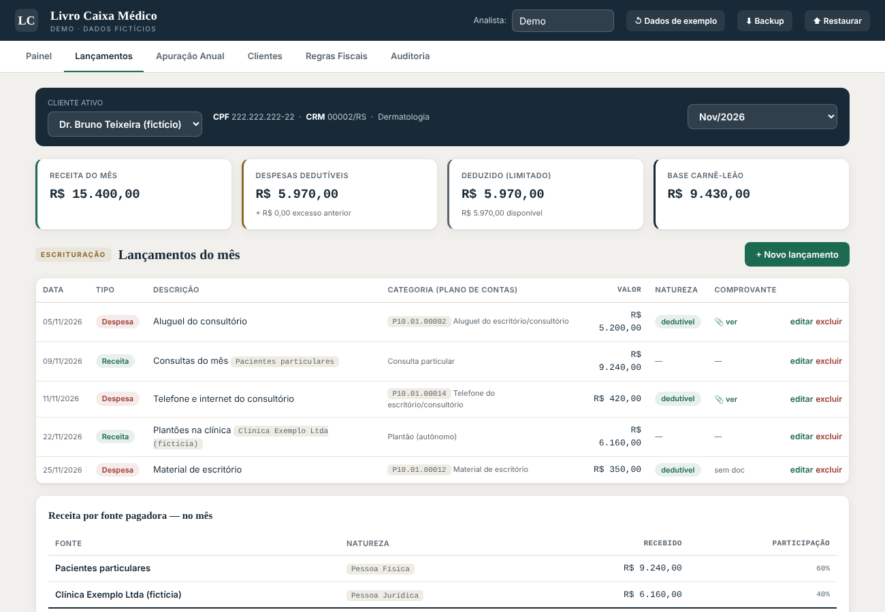
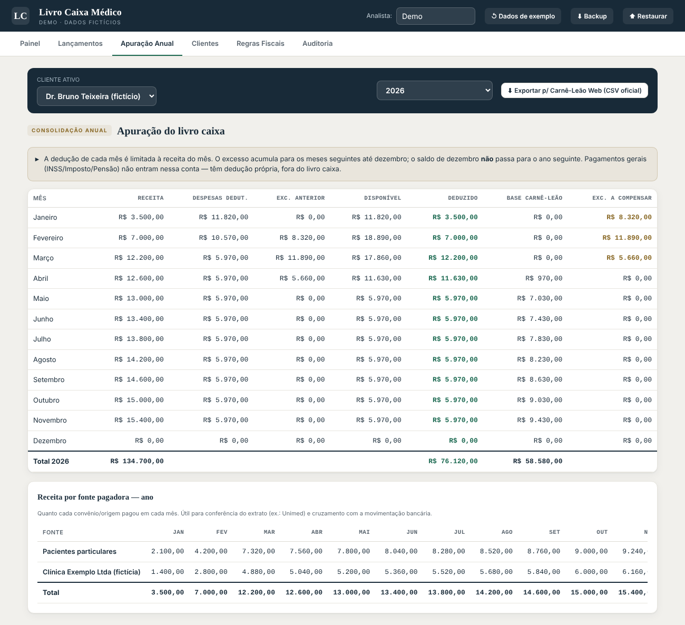

# Livro Caixa Médico

Aplicativo web para escrituração do livro caixa de médicos autônomos, com apuração mensal do limite de dedução e exportação no formato de importação do Carnê-Leão Web da Receita Federal.

*Imagens da versão de demonstração, com dados inteiramente fictícios.*

## O problema

Em escritórios que atendem médicos, o livro caixa costuma ser montado em planilhas soltas, cliente a cliente. Os erros se repetem: despesas sem categoria fiscal, gastos pessoais misturados com os do consultório, receita lançada como uma linha só por convênio, sem separar pessoa física de pessoa jurídica. Todo mês alguém precisa refazer a planilha à mão para gerar o arquivo da Receita, e a apuração do imposto fica sujeita a erro.

Além disso, a regra fiscal tem detalhes que uma planilha comum não controla:

- a despesa dedutível de cada mês é limitada à receita daquele mês;
- o excesso acumula para os meses seguintes, mas se perde em dezembro;
- só entram as contas do Plano de Contas Padrão do Carnê-Leão Web;
- INSS, imposto pago e pensão alimentícia têm dedução própria e ficam fora do livro caixa.

## O que o app faz

- **Carteira de médicos**, cada um com suas fontes pagadoras (particular, convênios, clínicas) e seus lançamentos.
- **Lançamentos classificados** pelo plano de contas oficial (P10 dedutível, P11 não dedutível, P20 pagamentos gerais), com anexo de comprovante.
- **Apuração anual automática**: receita, despesa dedutível, excesso do mês anterior, valor deduzido, base do Carnê-Leão e excesso a compensar, mês a mês.
- **Receita por fonte pagadora**, para conferir com o extrato do convênio e com a movimentação bancária.
- **Exportação em CSV** nos layouts de importação do Carnê-Leão Web (Recibo Saúde, Rendimentos do Trabalho Não Assalariado, pagamentos do plano padrão e pagamentos gerais).
- **Painel de pendências**: despesas dedutíveis sem comprovante anexado.
- **Trilha de auditoria** de tudo o que foi criado, editado ou excluído, e backup/restauração em arquivo.

### Lançamentos do mês

### Apuração anual com excesso acumulado

O Dr. Bruno (fictício) abre o consultório no início do ano com despesas maiores que a receita. A apuração limita a dedução à receita de cada mês e carrega o excesso até ele ser compensado.

## Como foi feito

- HTML, CSS e JavaScript puro, em um único arquivo, sem servidor nem dependências.
- Os dados ficam no próprio navegador (IndexedDB); nada é enviado para fora.
- Texto digitado é escapado antes de ir para a tela, e os CSVs são protegidos contra injeção de fórmula ao abrir no Excel.
- Construído com apoio de IA generativa, a partir das regras do Carnê-Leão Web e dos modelos oficiais de importação.
- O código-fonte não está publicado porque o app foi desenvolvido em contexto profissional. Posso apresentá-lo em funcionamento numa entrevista.

## Autor

Josias Lessa · economista (UFRGS) e graduando em Ciências Contábeis (UFRGS)
